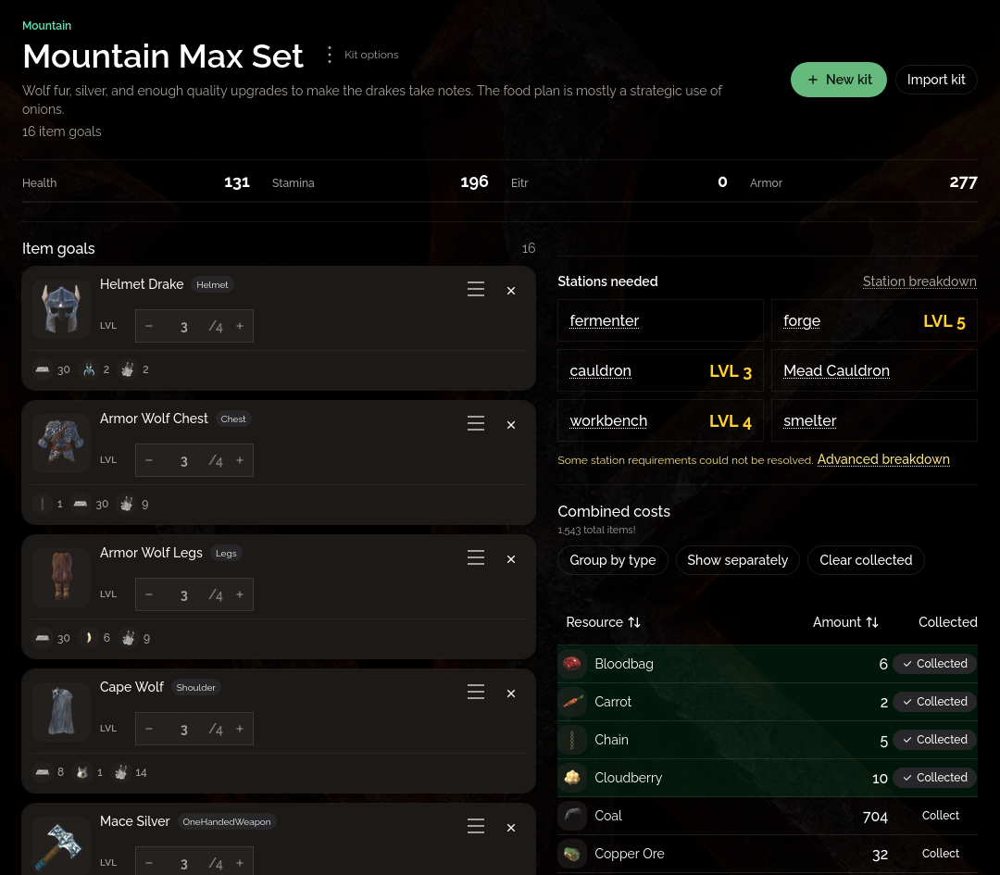

# Valkits

Valkits is a local-first Valheim kit planner. Create a kit for a biome or
progression milestone, add items and target quantities or quality levels, and
calculate the resources and crafting-station requirements needed for the kit.



The app runs entirely in your browser. Kits, preferences, and the latest
calculation for each kit are stored in that browser's local storage; they are
not uploaded or synchronized between browsers or devices. Use the kit
export/import actions to move a kit between devices.

## Try it

The GitHub Pages site is published at
[https://dsthedev.github.io/valkits/](https://dsthedev.github.io/valkits/).
On a new browser, choose a prebuilt kit such as **Meadows Starter** or **troll
stuff**, then select **Add example** to explore the planner.

## Local development

Requirements:

- Node.js 22.12 or newer (Vite 8 requirement)
- pnpm 10

Install dependencies and start the development server:

```sh
pnpm install --frozen-lockfile
pnpm dev
```

The development and production build scripts generate
`public/data/wackydb/catalog.json` from the checked-in WackyDatabase YAML files.
The generated catalog is intentionally ignored by Git; do not commit it.

Useful checks:

```sh
pnpm test
pnpm lint
pnpm typecheck
pnpm build
```

## Example kits

Checked-in starter kit exports live in [`src/data/examples/`](src/data/examples/).
To add a prebuilt kit:

1. Export a kit from the app, or create a JSON file using the same
   `{ "version": 1, "kit": { ... } }` format.
2. Add the file under `src/data/examples/`.
3. Register it in `exampleKitTemplates` in [`src/data/kits.ts`](src/data/kits.ts).

The app validates templates when loading them and assigns a fresh ID whenever a
user adds an example.

## Deploy to GitHub Pages

This repository includes a GitHub Actions workflow that tests, builds, and
publishes the site when changes are pushed to `main` (or when manually
dispatched). The workflow configures Vite for the `/valkits/` project-site path.

For the first deployment:

1. Push the workflow and site changes to the GitHub repository's `main` branch.
2. In the repository, open **Settings → Pages**.
3. Under **Build and deployment**, set **Source** to **GitHub Actions**.
4. Open the **Actions** tab and confirm that the **Deploy to GitHub Pages**
   workflow completes successfully.

The site URL is `https://dsthedev.github.io/valkits/`. If the repository is
renamed, update the Vite base path in [`vite.config.ts`](vite.config.ts) and the
site URL here. GitHub Pages availability and visibility depend on the
repository's plan and settings.

## Data and current limitations

- Game item, recipe, and piece source YAML is kept under `public/data/wackydb/`.
  The build generates the browser catalog from those source files.
- Example kits are app-owned JSON templates; user kits remain separate in local
  storage.
- Kit resources recursively expand known recipes and supported processing
  conversions. Quality upgrade inputs are included; recipe recovery flags and
  processing removal flags are not applied.
- Unknown, ambiguous, or unsupported item sources and station costs remain
  visibly unresolved. A partial plan is not a complete gather checklist.
- Storage estimates use resource stack sizes and imported chest capacities.
  Chest construction costs are direct materials, separate from kit costs; the
  estimate excludes finished kit items and may be incomplete with missing data.
- Previous calculations are retained per kit and marked stale when relevant
  kit inputs or game data changes.
- Clearing site data or using a different browser/device does not carry over
  saved kits. Export kits before clearing browser data.
